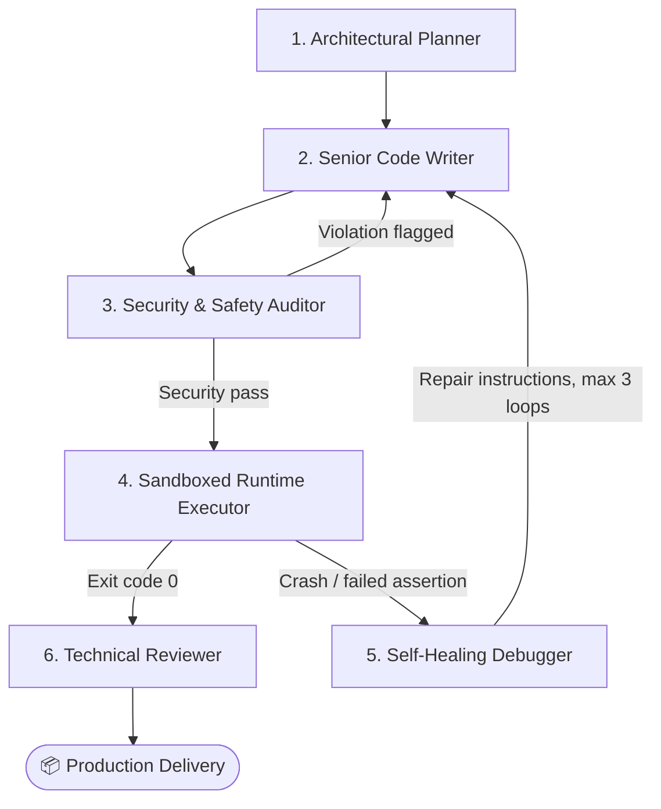

<div align="center">

# 💻 X-Estal Code Dev Agent

### Autonomous Software Engineering Multi-Agent Studio

**Plan → Write → Audit → Execute → Self-Heal → Deliver**

[](https://streamlit.io)
[](https://github.com/langchain-ai/langgraph)
[](https://www.python.org/)
[](https://opensource.org/licenses/MIT)
[](#-supported-ai-providers)

*Engineered by **x-estal nitish** (Nitish Kumar)*

[Quickstart](#-quickstart) · [Architecture](#-multi-agent-architecture) · [Providers](#-supported-ai-providers) · [Deploy](#-deploy-to-streamlit-cloud) · [Connect](#-developer--connect)

</div>

---

## 📑 Table of Contents

- [Overview](#-overview)
- [Why This Is Different](#-why-this-is-different)
- [Key Features](#-key-features)
- [Multi-Agent Architecture](#-multi-agent-architecture)
- [Supported AI Providers](#-supported-ai-providers)
- [Quickstart](#-quickstart)
- [Configuration](#-configuration)
- [Deploy to Streamlit Cloud](#-deploy-to-streamlit-cloud)
- [Safety Notes](#-safety-notes)
- [Troubleshooting](#-troubleshooting)
- [Roadmap](#-roadmap)
- [Contributing](#-contributing)
- [Developer & Connect](#-developer--connect)
- [License](#-license)

---

## 🌟 Overview

**X-Estal Code Dev Agent** is an autonomous, multi-stage software engineering system built on **LangGraph** with a modern **Claymorphism Streamlit UI**.

Give it a task in plain English. It plans the solution, writes the code, audits it for unsafe patterns, runs it in an isolated subprocess, and, if something breaks, reads the traceback and fixes its own code automatically.

## 🔥 Why This Is Different

| Typical single-shot LLM generator | X-Estal Code Dev Agent |
| :--- | :--- |
| Writes code once and hopes it works | Writes, **runs**, and verifies the code |
| Errors are your problem | Traceback → root-cause analysis → automatic fix |
| No safety checks | Static security audit before anything executes |
| Black box | Live pipeline visualizer + real-time terminal |
| Needs an API key | Built-in offline mode, **zero config** |

---

## ✨ Key Features

- 🔁 **Stateful cyclical graph:** built with LangGraph, with conditional routing between agents.
- 🩺 **Self-healing loop:** failed runs are diagnosed and repaired, up to 3 iterations.
- 🛡️ **Pre-execution security audit:** blocks dangerous patterns before code ever runs.
- ⚡ **Timed subprocess execution:** default 15s timeout, with captured stdout, stderr and exit code.
- 🎨 **Claymorphism UI:** soft 3D look with layered shadows and inner bevel highlights.
- 📊 **Live pipeline visualizer:** watch all 6 agent stages in real time.
- 🖥️ **Dark clay terminal:** live console output, test status and execution time.
- ⬇️ **1-click download:** get the generated script instantly.
- 🧪 **Sandbox playground:** run your own scripts on demand.
- 🧰 **150-Tool Agent Explorer:** searchable catalog of 150 agentic tools across 18 categories.
- 🔌 **Multi-provider:** Groq, Gemini, OpenAI, a local model, or the built-in offline synthesizer.

---

## 🏗️ Multi-Agent Architecture



<details>
<summary><b>ASCII version (for viewers without Mermaid support)</b></summary>

```
                    ┌───────────────────────────────┐
                    │  1. Architectural Planner     │
                    └──────────────┬────────────────┘
                                   │
                                   ▼
                    ┌───────────────────────────────┐
                    │    2. Senior Code Writer      │◄──────────┐
                    └──────────────┬────────────────┘           │
                                   │                            │
                                   ▼                            │
                    ┌───────────────────────────────┐           │
                    │   3. Security & Safety Auditor│           │
                    └───────┬──────────────┬────────┘           │
            [Security Pass] │              │ [Violation Flagged]│
                            ▼              │                    │
        ┌─────────────────────────────┐    │                    │
        │ 4. Sandboxed Runtime Exec   │    │                    │
        └───────┬──────────────┬──────┘    │                    │
    [Exit == 0] │              │ [Crash]   │                    │
                ▼              ▼           ▼                    │
    ┌───────────────────────┐  ┌─────────────────────────────┐  │
    │ 6. Technical Reviewer │  │ 5. Self-Healing Debugger    │──┘
    └───────────┬───────────┘  └─────────────────────────────┘
                │
                ▼
     [Production Delivery]
```

</details>

### Agent Roles

| # | Agent | Responsibility |
| :-: | :--- | :--- |
| 1 | 📐 **Architectural Planner** | Analyzes requirements, breaks down dependencies, outlines implementation steps, and defines security/performance constraints. |
| 2 | ✍️ **Senior Code Writer** | Writes clean, PEP8-compliant code with docstrings, type hints, and embedded test assertions under `if __name__ == '__main__':`. |
| 3 | 🛡️ **Security Auditor** | Scans for prohibited patterns: `rm -rf` wipes, `shutil.rmtree('/')`, fork bombs, interactive PTY shells and unauthorized network hooks. |
| 4 | ⚡ **Runtime Executor** | Runs the code in an isolated subprocess with a strict timeout (default 15s) and captures stdout, stderr and return code. |
| 5 | 🩺 **Self-Healing Debugger** | Parses the traceback, finds the root cause, and sends precise repair instructions back to the Code Writer (up to 3 iterations). |
| 6 | 📦 **Production Reviewer** | Produces the delivery report and complexity analysis, and offers the code for download. |

---

## 🧠 Supported AI Providers

| Provider | Models | Setup |
| :--- | :--- | :--- |
| ⚡ **Groq** *(recommended)* | `llama-3.3-70b-versatile`, `qwen-2.5-coder-32b` | Free API key from [Groq Console](https://console.groq.com) |
| 🔷 **Google Gemini** | `gemini-1.5-flash`, `gemini-2.0-flash` | API key from [Google AI Studio](https://aistudio.google.com) |
| 🟢 **OpenAI** | `gpt-4o-mini`, `gpt-4o` | API key from [OpenAI](https://platform.openai.com) |
| 💾 **Local / Offline** | `Spark-X2.5-4B` | `llama-server` or Ollama at `http://127.0.0.1:8088/v1` |
| 🤖 **Autonomous Built-in** | Resilient Template Synthesizer | **Zero configuration**: works offline and in demo mode |

> 💡 **No API key?** Pick *Autonomous Built-in* and the app runs out of the box.

---

## 🚀 Quickstart

**Prerequisites:** Python 3.10+ and Git.

**1. Clone the repository**

```bash
git clone https://github.com/XestalNitish/code-dev-agent.git
cd code-dev-agent
```

**2. Create a virtual environment and install dependencies**

```bash
python -m venv .venv

# Windows
.\.venv\Scripts\activate

# Linux / macOS
source .venv/bin/activate

pip install -r requirements.txt
```

**3. Launch the app**

```bash
streamlit run app.py
```

Open **http://localhost:8501** in your browser. 🎉

---

## ⚙️ Configuration

You can paste your API key in the app's sidebar, or set it as an environment variable:

```bash
# Linux / macOS
export GROQ_API_KEY="gsk_..."

# Windows (PowerShell)
$env:GROQ_API_KEY = "gsk_..."
```

| Variable | Provider |
| :--- | :--- |
| `GROQ_API_KEY` | Groq |
| `GEMINI_API_KEY` | Google Gemini |
| `OPENAI_API_KEY` | OpenAI |

> 🔒 Never commit API keys to Git. Add your `.env` / `secrets.toml` files to `.gitignore`.

---

## 🌐 Deploy to Streamlit Cloud

1. Push this repository to your GitHub account.
2. Go to [share.streamlit.io](https://share.streamlit.io/) and click **New app**.
3. Select:
   - **Repository:** `XestalNitish/code-dev-agent`
   - **Branch:** `main`
   - **Main file path:** `app.py`
4. *(Optional)* Add keys under **Advanced settings → Secrets**:

   ```toml
   GROQ_API_KEY = "gsk_..."
   OPENAI_API_KEY = "sk-..."
   GEMINI_API_KEY = "AIzaSy..."
   ```

5. Click **Deploy** and your agent is live. 🚀

---

## 🛡️ Safety Notes

- The Security Auditor is a **pattern-based static check**. It catches known dangerous constructs but is not a guarantee against every malicious script.
- Generated code runs in a **separate subprocess with a timeout**, which is not a full container or VM sandbox.
- For maximum safety, **run the app inside Docker or a VM**, especially when hosting it publicly or running untrusted prompts.
- Always review generated code before using it in production.

---

## 🩹 Troubleshooting

| Problem | Fix |
| :--- | :--- |
| `ModuleNotFoundError` | Activate your virtual environment, then run `pip install -r requirements.txt`. |
| Streamlit command not found | Run `python -m streamlit run app.py`. |
| API key rejected | Check for extra spaces and confirm the key matches the selected provider. |
| Local model not connecting | Make sure `llama-server` / Ollama is running on port `8088`. |
| Execution timed out | The default timeout is 15s, so simplify the task or raise the limit in the config. |
| Port 8501 already in use | Run `streamlit run app.py --server.port 8502`. |

---

## 🗺️ Roadmap

- [ ] Support for more languages (JavaScript, C++, Java)
- [ ] Docker-based execution sandbox
- [ ] Multi-file project generation
- [ ] Persistent run history and exportable reports
- [ ] Optional human-in-the-loop approval step

---

## 🤝 Contributing

Contributions, issues and feature requests are welcome!

1. Fork the repo
2. Create your branch: `git checkout -b feature/amazing-feature`
3. Commit your changes: `git commit -m "Add amazing feature"`
4. Push: `git push origin feature/amazing-feature`
5. Open a Pull Request

If this project helped you, please consider giving it a ⭐ on GitHub!

---

## 👨‍💻 Developer & Connect

**x-estal nitish** (Nitish Kumar)

[](https://www.instagram.com/x_estal_nitish)
[](https://github.com/XestalNitish)
[](https://www.linkedin.com/in/nitish-kumar-33714642b/)

### 🚀 More Live Apps

| App | Description |
| :--- | :--- |
| [🔎 Research Agent](https://xestal-research-agent-by-x-estal-nitish.streamlit.app/) | Autonomous web and literature research synthesizer |
| [₿ Bitcoin Price Predictor](https://x-estal-nitish-bit-coin-price-predictor.streamlit.app) | ML-powered cryptocurrency forecasting engine |
| [🧠 Brain Tumor Classifier](https://brain-tumor-classifier-by-x-estal-nitish.streamlit.app) | Deep learning MRI classification system |

---

## 📄 License

Distributed under the **MIT License**. See [`LICENSE`](LICENSE) for details.

<div align="center">

Developed with 💜 by **x-estal nitish** (Nitish Kumar)

</div>
